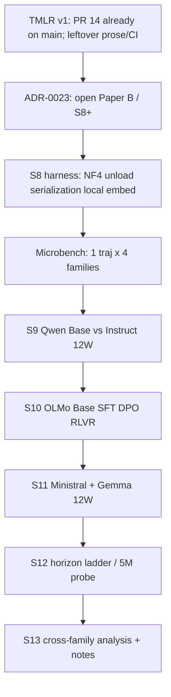

# Paper B: локальная 4-family программа и горизонт 5M

Это не косметическое расширение TMLR v1 и не «ещё один model sweep». Это **Paper B** из [docs/backlog.md](docs/backlog.md): *what determines the long-run dynamical regime of a self-conditioned LM after complete prompt eviction*. Планируемые стадии S0–S7 закрыты; [docs/research-plan.md](docs/research-plan.md) сейчас явно говорит «there is no S8». Первый научный акт — ADR, который это предложение отменяет.

Центральный claim v2 остаётся узким. Не «semantic attractors», не «generic semantic memory», не «свойство всех LLM». Формулировка:

> В фиксированном blockwise self-conditioning режиме (P1) конечноконтекстная LLM может сохранять измеримую зависимость поздней динамики от исходного текста спустя много полных оборотов окна после физической эвикции исходных токенов. Эта зависимость реализуется преимущественно через seed-conditioned выбор позднего повторяющегося режима. Paper B спрашивает, **как этот режим меняется от post-training и архитектуры attention**, а не доказывает универсальность.

50k токенов **не слишком мало** для existence claim: 19/20 уже lock на 12 оборотах. 5M токенов **слишком дорого как default** и научно нужны только как тест на escape / медленный распад \(G_t\), не как замена 12W-матрицы.



S9–S11 уже должны давать **законченную** научную историю (anchor / ladder / replication+generalization). S12 не нужен, чтобы понять ценность Paper B: либо редкие long-horizon переходы, либо отдельный отрицательный результат *no confirmed escape through T*. Не ждать S12 и не расширять матрицу концептуально дальше.

---

## Freeze block — вписать в ADR-0023/0025 до любого generate и не менять после просмотра S9–S12

Четыре якоря. Смена любого после данных = новый ADR + объявление exploratory, не confirmatory.

### F1. Degeneracy construct + `N_confirm = 3`

Копия текущих калиброванных default из [degeneracy.py](src/semantic_afterlife/analysis/degeneracy.py) `DegeneracyParams` (chunk=1024, тот же tokenizer-independent text measures):

- `ngram = 3`
- `loop_repetition_threshold = 0.083`
- `loop_chunk_fraction = 0.5`
- `shingle_n = 5`
- `fixed_point_threshold = 0.0122`
- `novelty_threshold = 0.872`
- `self_similarity_threshold = 0.98` (только если embeddings поданы; не единственный lock criterion)
- Trajectory `degenerate` := looping **или** late-window fixed-point, как в коде сейчас
- **`N_confirm = 3`:** lock := ≥3 последовательных оборота `degenerate=true`; escape := ≥3 последовательных оборота `degenerate=false` после confirmed lock
- Exact-cycle hash не входит в lock/escape verdict

**Запрет:** менять пороги, `N_confirm`, chunk_size или определение `degenerate` после просмотра результатов S9–S12. Re-calibrate (`scripts/calibrate_degeneracy.py`) только если заранее сменён chunk/tokenizer — это новый ADR **до** generate, не mid-stage.

### F2. Пять INT8 seeds — выбраны сейчас, до NF4 Paper B

Правило (механическое, не по S5 lock-rate): **чётные индексы 0,2,4,6,8** среди десяти domain id в порядке [seed_bank_v1.yaml](configs/seeds/seed_bank_v1.yaml), twins исключены.

Замороженный список:

- `physics`
- `biology`
- `love`
- `programming`
- `surreal`

INT8 descendants: **`s1`, `s2`** (первые два из `{1,2,3,4}`). Итого 5×2×2 = 20 траекторий. Не подменять seed после того, как увидели NF4 \(G_t\) или lock.

Native-chat reduced (Qwen и Ministral): первые два INT8 seed × те же `s1,s2` = **`physics`, `biology`**. Вложенность в INT8-список — чтобы не плодить третий произвольный набор.

### F3. L2 locked-seed rule — без ручного выбора

На каждом checkpoint, **после** L0, среди seeds, у которых ≥1 descendant достиг confirmed lock (`N_confirm=3`):

1. Seed-level \(\tau_{\mathrm{lock}}\) := **медиана** time-to-confirmed-lock по locked descendants этого seed (unlocked descendants не входят в медиану).
2. Взять seed с **наименьшим** \(\tau_{\mathrm{lock}}\) и seed с **медианным** \(\tau_{\mathrm{lock}}\) в этом qualifying set.
3. Ничья: раньше в `seed_bank_v1.yaml` domain order.
4. Если qualifying seed ровно 2 — оба. Если 1 — L2-escape PARTIAL на одном seed, не подставлять unlocked. Если 0 — **нет** L2-escape на этом checkpoint; рассматривать только optional L2-persistence-to-lock.
5. На каждый выбранный seed — 2 descendants: предпочесть уже locked (`s` с меньшим \(\tau_{\mathrm{lock}}\); ничья — меньший stochastic id). Не выбирать «самый красивый» late text.

Запрещено смотреть UMAP / fingerprint labels / \(G_t\) при отборе.

### F4. Primary estimands (confirmatory vs exploratory)

**L0 / S9–S11 (порядок важности, confirmatory):**

1. \(G_t\) — seed-conditioned representation gap vs turnover (два local spaces, seed-cluster bootstrap, LOO).
2. \(\tau_{\mathrm{lock}}\) / prefix lock dynamics — time-to-confirmed-lock, counts по seed.
3. Fingerprint agreement — within-seed vs between-seed agreement и counts recurrent fingerprints.

**L2 (отдельный confirmatory, только S12):**

1. \(\tau_{\mathrm{escape}}\) — time from confirmed lock to confirmed escape, цензурированное общим \(T_{\min}\).

Всё остальное exploratory, пока не повышено отдельным ADR **до** анализа: native-chat Δ, INT8 concordance (важно для limitations, но не третий L0 headline), period-hash mutations, MI, MSM, MSD α, L1 48W, L2-persistence-to-lock, Gemma sliding-window storytelling beyond «не реплицировалось / full-attn не необходим».

Если появится 30 графиков — confirmatory только эти 2–3 (L0) плюс \(\tau_{\mathrm{escape}}\) (L2).

---

## 0. Ответ на вопрос «а вдруг 50k мало и надо 5M?»

### 0.1 Что уже измерено

Текущий occupancy operating point: `or-qwen3-8b`, P1 `raw_completion`, \(W=4096\), \(B_{\max}=1024\), \(T=0.3\), 12 turnovers, \(T_{\mathrm{gen}}=12W=49152\) токенов. На этом горизонте:

- 19/20 trajectories repetition-locked; 10/10 seeds дали ≥1 lock; `love` дал 1/2.
- last-band seed-conditioned gap положителен в трёх **пробах одних и тех же 20 траекторий** (BGE-M3 ≈0.201, Qwen3-Embedding-8B ≈0.390, Gemini ≈0.150).
- H1/MSM: validated metastability **не** найдена.
- процесс — externally sustained self-conditioning после stop/EOS (mean fill ≈0.853, stop-block fraction ≈0.359).

То есть к ~50k система **уже** в позднем режиме. Нехватка горизонта — не причина, по которой existence claim слаб. Слабы generalization, construct validity (1 текст/domain) и потеря raw F4 vectors.

### 0.2 Что 5M реально проверяет

\(5\times10^6 / 4096 \approx 1220.7\) оборотов. Это в ~102 раза длиннее текущего \(T\).

Три разные гипотезы, которые нельзя смешивать:

1. **Slow decay.** \(G_t = d_{\mathrm{between}}(t)-d_{\mathrm{within}}(t)\) ещё положителен на 12W, но упадёт к нулю на сотнях оборотов. Тогда 12W — premature last-band.
2. **Lock is long-lived, not proven absorbing.** После lock траектория часто выглядит как период-\(k\) цикл. 5M тогда есть waiting-time experiment: наблюдается ли **escape** на достигнутом горизонте. Нельзя установить \(P(\mathrm{escape})=0\). ADR-0019 парковал EOS-as-absorbing; Paper B тоже не называет lock absorbing.
3. **Base не успевает залочиться.** Instruct lockится к 3–6W; Base блуждает и, возможно, lockится только на \(10^2\)–\(10^3\) оборотах. Это **другой estimand** (\(\tau_{\mathrm{lock}}\)), не escape. Не смешивать с \(\tau_{\mathrm{escape}}\) в одном L2-кохорте.

Гипотеза «нам просто мало шагов, поэтому мы не увидели семантические аттракторы» — слабая. H1 провален не из-за короткого \(T\), а потому что lock ≠ metastable semantic state, и CK/timescale-separation не держатся. 1220 оборотов одного и того же 17-грамм цикла не создадут MSM-аттрактор.

### 0.3 Почему 5M × 10 checkpoint невозможно

Движок это **переживёт**: [src/semantic_afterlife/generation/window.py](src/semantic_afterlife/generation/window.py) явно считает стоимость шага \(O(W)\), не \(O(T)\). Логи запросов уже не пишут полный prompt, только `prompt_sha256` + 400-символьные head/tail ([trajectory.py](src/semantic_afterlife/generation/trajectory.py) `_write_request_record`). Resume есть.

Убивает **decode time**.

Грубая оценка при batch=1, NF4, \(W+B\le5120\), средние 25–50 tok/s (8B быстрее, Gemma 12B медленнее; prefill 4096 дешёвый относительно decode 1024):

- 1 траектория 12W (49k): 15–35 минут.
- 1 траектория 5M: **28–55 часов**.
- Полная матрица 10 ckpt × 10 seeds × 4 descendants × 12W: \(400\times49152\approx 19.7\)M output tokens ≈ **5–10 суток** непрерывной 4080.
- Та же матрица × 5M: \(\approx 2.0\times10^9\) output tokens ≈ **1.3–2.5 года** на одной карте.

P1 дополнительно делает ~\(T/B\) prefill окон. При fill 0.85 шагов больше, чем \(T/B\). На 5M это ~5800 generate() на траекторию. Это не катастрофа по VRAM, это катастрофа по wall-clock.

Поэтому **5M не является primary horizon**. Primary остаётся 12W — иначе Paper B нельзя сравнить с discovery experiment. Ultra-long — отдельная стадия на **крошечном** подмножестве, выбранном после 12W.

### 0.4 Лестница горизонтов (единственный допустимый дизайн)

Три уровня, фиксируются ADR до генерации:

- **L0 — primary, все 10 условий.** \(R=12\), \(T=49152\). Сопоставимо с S5/S6. На этом уровне живут \(G_{12}\), lock rate, time-to-lock, late-state diversity, LOO, 4 descendants.
- **L1 — medium, только если L0 это оправдывает.** \(R=48\) (\(T\approx196608\)) на Qwen Base+Instruct и на одном «интересном» другом семействе (если Base не lockится к 12W, или \(G_t\) ещё растёт). Решение принимает supervisor после S9, не executor.
- **L2 — два раздельных estimand, не одна смешанная кохорта.** Научное время — **token horizon**, не wall-clock. Wall-clock — только операционный стоп оркестратора.

  **L2-escape (primary, единственный default).** Вопрос: сколько живёт уже установленный late lock?

  - Когорта: до \(2\) checkpoint × \(2\) locked seeds × \(2\) descendants \(= 8\), только если qualifying locks есть. Отбор seeds **строго F3**, не вручную.
  - Estimand: \(\tau_{\mathrm{escape}}\) — время от confirmed lock до confirmed escape, цензурированное достигнутым \(T\).
  - Запрещено называть результат «доля absorbing». Максимум: *no escape observed through \(T\) tokens / \(T/W\) turnovers*. Термин: **long-lived repetition lock**.

  **L2-persistence-to-lock (optional, отдельный arm).** Вопрос: достигает ли ещё unlocked процесс lock на длинном горизонте?

  - Открывается **только если** на L0 у данного checkpoint почти нет locks (типичный кандидат: Qwen Base). Не «добивать» Base в escape-когорту искусственно выбранными unlocked seeds.
  - Estimand: \(\tau_{\mathrm{lock}}\). Другой PLAN-абзац, другая таблица, другой `run_id`. Не пулить с L2-escape.

  Если Instruct lockит, а Base нет — L2-escape только на Instruct; L2-persistence-to-lock только на Base. Не 8 траекторий «2 locked + 2 unlocked» под одним survival analysis.

**State machine lock/escape** (один construct на вход и выход):

```
unlocked → locked → escaped
```

- **Lock:** тот же degeneracy classifier, что L0 (looping / late Jaccard / entropy — не новый hash-тест). Подтверждение: \(\ge 3\) последовательных оборота `degenerate=true`.
- **Escape:** тот же classifier даёт `degenerate=false` \(\ge 3\) последовательных оборота. Не один оборот и не смена `sha256`.
- **Exact-cycle hash** (sha256 / period-k fingerprint окна): только диагностика *exact-cycle escape*. Если hash сменился, а degeneracy всё ещё lock — это мутация цикла, не escape.
- Sparse embed после confirmed lock: 1 chunk / оборот + полный dump при смене period-hash (диагностика), не эмбеддить 4883 почти-идентичных chunk.

**Цензурирование / wall-clock.** Запрещён cutoff «14 суток, кто успел». Sequential 8×5M иначе даёт order-dependent censoring (первые 5M, последние 500k). Правила:

- Единственная научная ось — достигнутый token horizon.
- При PARTIAL сравнивать группы **только до общего достигнутого \(T_{\min}\)** внутри контраста (например оба Qwen checkpoint до одного и того же \(T\)).
- Внутри checkpoint запускать L2 **round-robin по шагам/блокам** (N оборотов на traj A, затем B, …), либо чередовать куски resume, чтобы ни одна траектория не ушла далеко вперёд.
- Операционный потолок (например 14 суток) может остановить железо; отчёт тогда PARTIAL на \(T_{\min}\), не «первые закончили, остальные не считаем».

Анализ L2 — две survival-таблицы (\(\tau_{\mathrm{escape}}\) и при необходимости \(\tau_{\mathrm{lock}}\)), не last-band на 1220-м обороте. Ось: log-turnover bands плюс lock-relative time. Last-band при 1220W бессмыслен как аналог S5 band 12; для сопоставления с L0 пересчитывать оборот 12 на тех же ids.

### 0.5 Что ломается в анализе при наивном 5M

Подтверждено аудитом анализа ([Explore analysis scalability](dbf8dbcd-427e-4f09-8977-ff8b41a62f9b)):

- [recurrence_matrix](src/semantic_afterlife/analysis/geometry.py) — \(O(n_{\mathrm{chunks}}^2)\) память. На 48 chunk безопасно. На 4883: \(\sim 190\) MB float64 на траекторию — ещё живёт. На конкатенации всех chunk всех траекторий — нет. Запретить pooled recurrence.
- **Late-window Jaccard** в [degeneracy.py](src/semantic_afterlife/analysis/degeneracy.py) — \(O(n^2)\) set-Jaccard на второй половине chunk. Комментарий в коде: «chunk counts here are in the hundreds». На 4883 chunk это ~3M pairwise Jaccard **на одну траекторию**. На 8 L2-траекториях без subsample — CPU-дни. На 400×5M — нельзя запускать as-is. L2: prefix lock-time + subsampled late window (например 64 chunk), не полный half-series.
- **Separation `pairwise_distances`** — \(O(n_{\mathrm{traj}}^2 \times n_{\mathrm{chunks}})\). 400 traj × 4883 chunk материализует сотни миллионов строк. Даже 8×5M нельзя скармливать текущему `analyze separation` вместе с L0-матрицей. L2: log-bands + last-band only + не джоинить в один pairs parquet с 400 L0.
- MSM/VAMP на 4883 точках одного lock-цикла даст 1 микросостояние. Pooled Leiden на 1.9M frames — OOM. Не открывать H1 заново на L2 locked subset. MSM только если degeneracy rate < 50% на данном checkpoint.
- **`P(lock by t)` в коде нет.** Есть только verdict на полной траектории. Prefix/survival — новый pass в W1-B5, иначе time-to-lock останется прозой.
- **Semantic half-life в `src/` не реализован.** Methodology §3.4 есть, CLI нет (ADR-0008 ушёл в convergence). Не планировать `afterlife analyze half-life`. Headline Paper B — \(G_t\) и lock hazard, не \(T_{1/2}\).
- F4 last-band как «последний оборот» при 1220 оборотах — другой estimand, чем 12-й из 12. Не сравнивать с S5 last-band без пересчёта оборота 12 на тех же L2-траекториях (internal replication).
- Default `turnover_bin = 2.0` при 1220 оборотах даёт ~610 bands. Запрещено. Log-bands до кода L2.
- Response cache ([providers/cache.py](src/semantic_afterlife/providers/cache.py)) ключует полный prompt. На L2 это тысячи уникальных W-окон. Для ultra-long: `cache: steps_only` (JSONL достаточен для resume). Иначе cache раздуется на десятки GB.
- Хостинговые оценки «~$18 generate / ~$1800 на 400×5M» из аудита **не применяются**: Paper B generate локальный, $0. Риск — wall-clock и диск embed cache (~380 MB на 400×12W в двух spaces; ~1.2 GB на 8×5M в трёх), не ledger.

---

## 1. Граница с TMLR v1

TMLR correctness pass (ADR-0019…0022) **не смешивается** с Paper B generate.

Факт из аудита стадий ([Explore stages skills ADRs](e1bd8a8d-e457-46d0-8337-53644d4443e8)): **PR #14 уже влит в `main`** (`cursor/tmlr-correctness-a7f7` → `main`). Paper B режется от текущего `main`, а не «после будущего merge». Пункт «merge PR #14» из восьми leftover **снят**. Occupancy replication (ADR-0022) тоже уже сделана как *replication panel*, не restore.

Оставшийся v1-cleanup (без generate), если ещё не закрыт на HEAD:

1. CI / `ruff format --check`, если снова красный.
2. P1: \(B\) = max block; README всё ещё содержит `S = B` как exact stride ([README.md](README.md) ~строка 59).
3. Демотировать F4 `p=.0001` до pair-cell calibration, если manuscript ещё продаёт его как inferential p.
4. Не продавать CP `[0.751, 0.999]` как population CI.
5. Синхронизировать README / CITATION / seed-bank rationale с manuscript (half-life, MSM, currents, basins всё ещё в таблице README как «what we measure»).
6. Добавить Execution Horizon Laws и уточнить novelty.
7. Никакой идентифицирующей ссылки `AdamCage/...` в anonymous bundle.
8. Tag / archive закрытого v1 record; ADR-0021 остаётся provenance limitation.

Перед открытием S8 обязательны отдельные ADR (не один «большой»): (i) отмена «there is no S8» + объект/бюджет Paper B; (ii) выбор 10 checkpoint и local vs hosted; (iii) NF4/serialization/P1-only (P2 не включается); (iv) новые estimator'ы \(G_t\), prefix-lock, log-bands; (v) seed-bank rationale ≠ identification. Потолок проекта $200 (ADR-0013) для local generate не жмёт; любой hosted Gemini — estimate + human yes.

Paper B **не чинит** потерянные occupancy vectors регенерацией под старые `run_id`. Старый Qwen3-8B OpenRouter **не** является Instruct-половиной нового Base/Instruct сравнения. Discovery experiment остаётся Paper A; локальный Qwen Instruct — controlled replication.

Субагенты v1 и Paper B не пишут в одни и те же файлы manuscript/stage reports. Проза в `paper/main.tex` — только после явного human yes.

---

## 2. Научный дизайн матрицы

### 2.1 Четыре семейства, десять условий

Не «набрать N моделей». Четыре разных претензии:

- **Qwen3-8B** (`Qwen/Qwen3-8B-Base`, `Qwen/Qwen3-8B`) — anchor / post-training causality. Обязательно. Thinking у Instruct **выключен** и проверяется per-step (как reasoning guard в S0). Thinking-arm паркуется.
- **Ministral 3 8B** (`mistralai/Ministral-3-8B-Base-2512`, `mistralai/Ministral-3-8B-Instruct-2512-BF16`) — independent matched replication, BF16→NF4 с обеих сторон. Не брать FP8 Instruct. Не брать Reasoning-2512.
- **OLMo 3 7B Instruct line** — mechanistic post-training. Канонические id **проверяет** субагент ModelCardCensus (сейчас на Hub видны `allenai/Olmo-3-1025-7B` как base, `allenai/Olmo-3-7B-Instruct-SFT`, `...-DPO`, `allenai/Olmo-3-7B-Instruct` как RLVR). Think-линейка (`Olmo-3-7B-Think-*`) — отдельный parked arm, не путать.
- **Gemma 4 12B** (`google/gemma-4-12B`, `google/gemma-4-12B-it`) — architectural **generalization**, не causal ablation attention. Паттерн 5×sliding → 1×full, `sliding_window=1024`, внешний \(W=4096\). Если \(G_{12}>0\): *full attention на каждом слое не является необходимым условием* persistence в этом протоколе. Если эффект не реплицировался: только *не реплицировалось в Gemma condition* — одновременно отличаются family, training и размер. Не писать «значит виноват sliding 1024».

OLMo при \(W=4096\) и своём sliding 4096 **не** является architecture experiment. Продавать как post-training ladder.

### 2.2 Что держим константой

- Protocol P1 re-prompt, `raw_completion`, `unforced`, без system prompt.
- \(W=4096\), \(B_{\max}=1024\), temperature \(0.3\), `top_p=1.0`.
- Те же 10 domain seeds из [configs/seeds/seed_bank_v1.yaml](configs/seeds/seed_bank_v1.yaml). Twins (waterloo/reactor) **не** входят в F4 domain gap; отдельный F6-arm можно не повторять в Paper B.
- `stochastic_seeds: [1,2,3,4]` — 4 descendants. Within-seed pairs: \(\binom{4}{2}=6\) вместо 1.
- Serialization-controlled **primary:** одна и та же байтовая последовательность seed-токенов для Base и Instruct (`raw_bytes`). Это измеряет post-training effect **under a common raw-completion protocol**, не native chat deployment.
- **Native-chat reduced arm** на Qwen **и** Ministral (не только Qwen): 2 preregistered seeds × 2 descendants × {Base, Instruct} на семейство, если smoke template не ломает Tail_W. Не пулить с `raw_bytes`. Если цена после microbench велика — supervisor может оставить только Qwen; default плана — оба семейства.
- Квантизация: все 10 — официальные BF16 (или BF16-эквивалент) веса → **один и тот же** bitsandbytes NF4 (double quant, compute BF16).
- Qwen NF4↔INT8 control: список **F2** (`physics, biology, love, programming, surreal` × `s1,s2` × Base/Instruct = 20). Выбран до NF4 Paper B. Не менять.
- `max_concurrent: 1`. [run_experiment](src/semantic_afterlife/generation/trajectory.py) параллелит траектории семафором; два concurrent generate на 12 GB убьют Gemma.
- Старый hosted Qwen **не** входит в \(\Delta_{\mathrm{Instruct}}-\Delta_{\mathrm{Base}}\).

### 2.3 Что измеряем (новые зависимые величины)

Главная фигура Paper B — не «19/20 locks».

1. **Seed-conditioned gap vs turnover** \(G_t = d_{\mathrm{between}}(t)-d_{\mathrm{within}}(t)\).
2. **Lock dynamics:** prefix \(P(\text{lock by }t)\), time-to-lock. Писать counts по seed (4/4, 3/4), доля seeds с ≥1 и ≥3 lock. Не population binomial на 40 «iid» trajectories.
3. **Late-state diversity (headline, без MI):** число recurrent fingerprints; распределение descendants одного seed по fingerprints; within-seed vs between-seed fingerprint agreement. Не называть fingerprint «semantic state».
4. Для OLMo — те же кривые вдоль Base→SFT→DPO→RLVR в **двух primary local spaces** (BGE-M3, Qwen3-Embedding). Не пререгистрировать монотонность. Третье пространство (Gemini) — optional hosted, не часть exit criteria.
5. \(\Delta_{\mathrm{family}} = G_{12}^{\mathrm{post}}-G_{12}^{\mathrm{base}}\) и то же для lock-rate / time-to-lock. Сравнивать знак Qwen vs Ministral.

**Иерархия наблюдений (зафиксировать в ADR-0025 до S9):**

```
seed → descendant → chunk
```

- \(\binom{4}{2}=6\) within-seed distances — **не шесть независимых наблюдений**. Они делят те же 4 trajectories.
- Headline bootstrap: сначала resample **seeds**, внутри выбранного seed — descendants с multiplicity. Не resample chunks. Не трактовать 40 trajectories как iid Bernoulli.
- Kaplan–Meier / hazard: либо descriptive (no CI), либо uncertainty через **seed-cluster bootstrap**. Стандартный Greenwood CI на 40 trajectories запрещён.
- LOO-по-seed остаётся headline robustness для \(G_t\).
- Pair-cell randomization — calibration, не inferential p-value.
- Plug-in mutual information seed↔fingerprint **не headline**. При 40 trajectories и почти уникальных fingerprints MI upward-biased. Максимум exploratory с permutation / finite-sample correction, в приложении.
- Не называть результат semantic-domain memory. Seed-conditioned ensemble persistence in representation space. Seed-bank YAML пункт 2 переписать: дизайн не идентифицирует semantics vs register.

### 2.4 Pre-registered предсказания (черновик для PLAN.md; пустая колонка observed)

- Qwen Instruct \(P(\text{lock})\) ≫ Qwen Base на 12W; если нет — это сюрприз и главная находка.
- Если Qwen \(\Delta G\) и Ministral \(\Delta G\) одного знака — «не Qwen-specific». Если знаки разные — остановить обобщение, не усреднять семьи.
- OLMo: не предсказывать, какая стадия ломает динамику. Предсказывать лишь, что хотя бы одно смежное ребро |Δ| превысит LOO-устойчивый зазор Qwen или будет совместимо с нулём в **обоих primary local spaces**.
- Gemma: если \(G_{12}>0\) в обоих local spaces — *full attention на каждом слое не необходим* для persistence в P1. Если нет — *не реплицировалось в Gemma condition*, не «опровергнут sliding-window механизм».
- L2-escape: пререгистрация — *no confirmed escape through \(T=5\times10^6\)* для большинства escape-когорты (long-lived lock). Если confirmed escape массовый — rare-event сюжет, не MSM на 12W и не доказательство, что lock не бывает long-lived на меньшем \(T\).

---

## 3. Железо и инференс

### 3.1 Карта

Desktop RTX 4080 Super официально 16 GB. Пользователь назвал 12 GB — Wave 0 **измеряет** `nvidia-smi`, не верит спецификации. Оба бюджета закладываются.

- 12 GB: NF4 для всех 10; INT8 Qwen — только если microbench не OOM на \(W+B=5120\).
- 16 GB: то же + комфортный KV; INT8 Qwen почти наверняка.

BF16 8B/12B как primary — нет.

### 3.2 Стек

Предпочтение: **WSL2 Ubuntu → PyTorch CUDA → Transformers → bitsandbytes NF4**. Не LM Studio, не Ollama, не чужие GGUF. Причина — один алгоритм квантизации на официальных BF16.

Native Windows x86 bitsandbytes существует, но CUDA/WSL предсказуемее. Wave 0 фиксирует, что реально работает. Если только Windows — тот же NF4, те же тесты.

`uv sync --extra local --extra dynamics --extra dev`, плюс `bitsandbytes` в extra `local` (сейчас в [pyproject.toml](pyproject.toml) его нет: только torch, transformers, accelerate).

Один loading contract, попадает в `extra_body` и в manifest:

- `load_in_4bit: true`
- `bnb_4bit_quant_type: nf4`
- `bnb_4bit_use_double_quant: true`
- `bnb_4bit_compute_dtype: bfloat16`
- `device_map: cuda`
- `attn_implementation: sdpa` (или `flash_attention_2`, если microbench докажет выигрыш и стабильность; default sdpa)
- `revision: <pinned commit>`
- `tokenizer_revision: <pinned>`

INT8 control: `load_in_8bit: true` только на Qwen-ячейках.

### 3.3 VRAM-оценка (не бенчмарк)

Пиковый контекст одного `generate()` ≈ \(W+B=5120\), batch=1.

- Qwen/OLMo/Ministral text ~7–9B NF4: ~5–8 GB + KV. На 12 GB проходит.
- Gemma 4 12B NF4: ~7–10 GB + KV. Самая тесная. Если OOM — сначала `attn_implementation=sdpa`, потом урезать только Gemma \(B_{\max}\) **нельзя** (сломает сопоставимость). Fallback: Gemma 4-bit с `bnb_4bit_quant_type=nf4` + gradient/KV offload запрещён (меняет динамику). Если Gemma физически не лезет — ADR и замена на `gemma-4-E4B` **не** делается тихо: это другой scientific object. Стоп и вопрос человеку.

Не параллелить descendants. Цикл: все seeds×replicas одной модели → unload → `empty_cache` → следующая.

### 3.4 Диск

Веса BF16 десяти checkpoint ≈ 150–200 GB в HF cache. Плюс runs. Нужно **≥250 GB свободно** до download. Wave 0 измеряет.

L0 storage безопасен (сотни MB–несколько GB). L2 без полного prompt-cache — сотни MB. С полным cache — десятки GB; поэтому `steps_only`.

### 3.5 Лицензии / gated

- Qwen3: Apache, ungated.
- OLMo 3: AI2, обычно ungated.
- Ministral 3 2512: Apache 2.0, но extra_gated на карточках бывает — нужен `HF_TOKEN`.
- Gemma 4: gated, лицензия Google, `HF_TOKEN` + accept.

Smoke не стартует, пока все 10 репозиториев `huggingface-cli download` не проходят.

---

## 4. Что в harness сейчас не готово

Локальный путь есть ([ADR-0011](docs/decisions/ADR-0011-local-base-provider.md), [src/semantic_afterlife/providers/local.py](src/semantic_afterlife/providers/local.py)), но он писался под CPU Gemma 3 1B.

Дыры, которые **обязаны** закрыться в S8, иначе матрица — не эксперимент, а набор confounds:

1. **Нет bitsandbytes.** `TransformersBackend._load` знает только `device`/`dtype`/`attn_implementation`. NF4/INT8 нет. `_LOAD_KEYS` не содержит quant-полей — они ошибочно улетят в `model.generate(**extra)`.
2. **Нет unload.** `_resolved` держит модель навсегда. Десять условий на одной GPU требуют явного `aclose_model(model_id)` + `torch.cuda.empty_cache()`.
3. **Multimodal loaders.** Ministral 3 = `Mistral3ForConditionalGeneration` (8.4B text + 0.4B vision). Gemma 4 12B = multimodal, уже был warning для E2B. `AutoModelForCausalLM` может упасть. Нужен text-only generate path: тот же tokenizer, что определяет `Tail_W`; vision не вызывается.
4. **Qwen thinking.** Instruct по умолчанию думает. В P1 `raw_completion` thinking может всё равно пойти. Нужен per-step guard на think-токены / пустой visible text (как ADR-0005).
5. **Serialization.** `_messages_to_text` уже не применяет chat template — хорошо для Base. Для Instruct primary должен быть **тот же raw prompt**, не `apply_chat_template`. Иначе \(\Delta\) = weights + tokens + template. Нужен явный `serialization: raw_bytes | native_chat` в GeneratorConfig.
6. **`max_concurrent` default 4.** Для local GPU конфиги Paper B ставят 1; плюс assert в LocalClient: второй concurrent generate — ошибка.
7. **Local embeddings не реализованы.** `LocalClient.embed` бросает. Сейчас BGE-M3 и Qwen3-Embedding идут через RouterAI — это деньги и другой backend. Paper B должен эмбеддить **локально**: BGE-M3 всегда; Qwen3-Embedding-8B NF4 после выгрузки генератора. Gemini — optional hosted, только Qwen L0 subset, estimate+human yes.
8. **Provenance векторов.** ADR-0021. Каждый embed run пишет parquet + integrity hash + per-trajectory vector files, которые **не** могут быть единственной копией только на `runs/` без зеркала манифеста. Правило S8: `afterlife verify --stage N` падает, если нет `data/embeddings_*.parquet` и `data/vectors/<traj>.npy` (или эквивалент).
9. **P1 notation.** `block_size` уже max; README/methodology ещё говорят «receives B; slides by S=B exactly». Чинится в v1 и копируется в Paper B configs comments.
10. **P2 не писать в этой программе.** Парк ADR-0017. Одна 4080 не тянет P1-матрицу и P2.
11. **Seed-bank rationale** врёт про identification semantics vs register. YAML comment правится ADR, тексты seeds не редактируются (банк append-only).
12. **Tokenizer identity.** ADR-0011: проектный tokenizer, `add_special_tokens=False`, тот же, что Tail_W. Для Gemma/Ministral multimodal vocab 262k — проверить, что encode/decode roundtrip на seed-банке 10/10.
13. **P2 в YAML мёртв.** `WindowConfig.protocol` принимает `P2_sliding_attention`, но runner **нигде не читает** это поле ([Explore generation engine](0c079aa0-328f-46de-afb5-e896e78263f3)). Все траектории идут P1. Ставить `protocol: P2_sliding_attention` в Paper B YAML **запрещено** — создаст ложную запись в манифесте. P2 остаётся parked (ADR-0017).
14. **Факториал перемешивает модели.** `plan_trajectories` разворачивает `generators × windows × sampling × seeds × stochastic` в этом порядке, поэтому при нескольких generator в одном YAML шаги **чередуются по моделям**. На одной GPU это не даст unload. Нужен либо один generator на run_id, либо явный scheduler «все траектории модели A → unload → B». Предпочтение: **один checkpoint = один generate run**, оркестратор клеит анализ. `max_concurrent: 1` недостаточно, если в конфиге десять slugs.
15. **Клиенты живут в process-wide registry.** `build_client` кэширует LocalClient; `aclose` должен выгружать и registry, иначе unload в runner бесполезен.
16. **Потолка `target_tokens` нет.** Валидатор требует только `T ≥ W`. Для L2 нужен soft warning (диск / ETA) в `afterlife estimate`, не молчаливый 5M.
17. **`extra_body` сегодня частично утекает в `generate()`.** После фильтра `_LOAD_KEYS` остаток идёт в HF generate. Новые quant-ключи обязаны быть в `_LOAD_KEYS` до первого smoke, иначе `BitsAndBytesConfig` окажется sampler kwarg.

---

## 5. Стадии Paper B

Каждая стадия: своя ветка `stage-N` от `main` после merge предыдущей, `PLAN.md` по [40-stage-protocol.mdc](.cursor/rules/40-stage-protocol.mdc), YAML, estimate, human yes, generate, degeneracy-first, artifacts, REPORT, `afterlife review --stage N` exit 0, supervisor, `--no-ff` merge.

### S8 — Paper B foundations (как S0, без научных claims)

- ADR-0023: открыть S8+, матрица, NF4 protocol, serialization-controlled primary, horizon ladder, 4 descendants, local embeddings, «старый OpenRouter Qwen не matched Instruct».
- ADR-0024: quant+unload+multimodal loader.
- Код + тесты (inject backend, как [tests/test_local_client.py](tests/test_local_client.py)).
- `configs/models/generators_local_paperb.yaml` — 10 slugs + qwen int8 twins.
- `afterlife doctor` проверяет CUDA, VRAM, HF auth, все 10 revision pin.
- Smoke: 32 новых токена × 10 checkpoint, raw_completion, запись `hf_revision`, `quant_config`, peak VRAM.
- Exit: 10/10 load+32 tok; unload освобождает VRAM (±10%); ruff/mypy/pytest green; no generate beyond smoke.

Budget: $0 generate. HF download — не ledger USD, но диск да.

Нумерация **заморожена** (ADR-0023, не менять в HANDOFF):

```
S9 Qwen → S10 OLMo → S11 Ministral+Gemma → S12 long horizon → S13 synthesis
```

Не запускать 5M раньше L0-матрицы S9–S11.

### S9 — Qwen anchor 12W (обязательный научный эксперимент)

- Primary `raw_bytes`: 2 checkpoint × 10 seeds × 4 descendants = 80 траекторий × 49152 ≈ 3.93M output tokens.
- INT8 control: F2 `physics, biology, love, programming, surreal` × `s1,s2` × 2 checkpoints = **20** траекторий.
- Native-chat reduced: **F2** `physics`, `biology` × `s1,s2` × 2 checkpoints = 8, если smoke template не ломает окно.
- Embed: BGE-M3 + Qwen3-Embedding local (два primary spaces).
- Анализ: \(G_t\), prefix lock hazard, fingerprint diversity (без headline MI), seed-cluster bootstrap, LOO, degeneracy-first.
- Wall-clock: ~2–4 суток generate (80+20+8) + embed/analyze.
- Exit (уточнить в PLAN до данных): оба local spaces — одинаковый **знак** \(\Delta G\); LOO не меняет знак; INT8 vs NF4 сравнение на тех же 5 seeds, pre-registered допуск (калибровать на S5 scale, не угадывать 0.01).
- Если Base≈Instruct по lock и \(G\) — усиливается «autoregressive dynamics» чтение.
- Если Base≪Instruct — усиливается «post-training reshapes long-run regime». Оба — успех стадии.

Не начинать S10, пока S9 REPORT не скажет, что протокол (fill, stop, thinking=0, roundtrip, VRAM, raw_bytes identity) годен.

### S10 — OLMo mechanistic ladder 12W

- 4 checkpoint × 10 × 4 = 160 траекторий ≈ 7.86M tokens.
- Главная фигура Paper B: Base→SFT→DPO→RLVR для \(G_t\), prefix \(P(\mathrm{lock})\), time-to-lock, в двух local spaces.
- Не усреднять OLMo с Qwen в один «instruct effect».

### S11 — Ministral replication + Gemma architectural generalization 12W

- Ministral `raw_bytes`: 2 × 10 × 4 = 80 траекторий.
- Ministral native-chat reduced: 2 × 2 × 2 = 8, тот же протокол, что Qwen chat-arm.
- Gemma Base+IT `raw_bytes`: 2 × 10 × 4 = 80. Gemma последней (тесная VRAM). OOM → стоп, не тихая замена.
- Exit: знак \(\Delta_{\mathrm{Ministral}}\) vs \(\Delta_{\mathrm{Qwen}}\) записан; Gemma интерпретировать только как generalization (§2.1), не как causal attention test.

Код анализа S10/S11 можно готовить параллельно; GPU строго последовательно: Qwen → OLMo → Ministral → Gemma.

### S12 — Horizon ladder (после всей 12W-матрицы)

- L1 (48W) — только supervisor yes после S9–S11.
- **L2-escape primary:** отбор F3, confirmatory только \(\tau_{\mathrm{escape}}\). State machine F1, common-horizon / round-robin.
- **L2-persistence-to-lock** — exploratory/optional, только если L0 почти без locks. Не повышает F4.
- Exit: таблица \(\tau_{\mathrm{escape}}\); *no confirmed escape through \(T_{\min}\)*; exploratory log-band \(G_t\) не путать с L0 confirmatory.

### S13 — Cross-family synthesis

- Общие фигуры, таблицы, `paper/notes/` (не `paper/main.tex` без human yes).
- README v2 зеркало abstract Paper B.
- Literature: Execution Horizon Laws как сосед (task execution / survival), не как «нас опередили».
- Gate + supervisor. Merge закрывает Paper B experimental record.

Хостинг spend: $0, если эмбеддинги локальные. Потолок проекта $200 не тратить на generate. Если Gemini subset — estimate и спросить.

---

## 6. Субагентная реализация (главный акцент)

Оркестратор — этот чат / человек. Субагенты **узкие**. Никто не «сделай Paper B». Каждый получает файлы, skill, запреты и схему возврата. Модели: `inherit`, если человек не просит иначе. `environment: local`. Не cloud.

Общие запреты всем executor-агентам:

- Не тратить API-деньги без estimate + human yes.
- Не писать `paper/main.tex`.
- Не менять degeneracy thresholds без ADR.
- Не редактировать тексты seed_bank (только comments/rationale).
- Не стартовать stage N+1 без REPORT N и review exit 0.
- Не rebase stage branch после push.
- Не параллелить два generate на GPU.
- Не подменять checkpoint молча.


### Wave 0 — параллельные readonly агенты (explore / generalPurpose)

Запускать **одним сообщением, 4× Task parallel**.

**W0-A HardwareCensus**

- Skill: нет; tools: Shell readonly (`nvidia-smi`, `wmic`/`lsblk`, `wsl -l -v`, `python -c torch.cuda`).
- Вернуть: GPU name, VRAM total/free, driver, CUDA, WSL2 present, free disk on HF cache path, RAM, Windows build.
- Вердикт: `vram_budget: 12|16`, `os_lane: wsl2|windows_native|blocked`.
- Не ставить пакеты.

**W0-B ModelCardCensus**

- Skill: huggingface-papers / hf-cli по необходимости.
- Для каждого из 10 id: exists, gated, license, `revision` main SHA, architecture class, `sliding_window`, hidden/layers/heads, weight dtype on Hub, filesize, `transformers` min version, chat template presence, thinking flags.
- OLMo: точно ли base = `Olmo-3-1025-7B` vs `Olmo-3-7B`; не смешать Think и Instruct.
- Ministral: подтвердить Instruct-BF16, не FP8.
- Вернуть таблицу-YAML-черновик для `generators_local_paperb.yaml` (в ответе, не писать файл если Plan mode — в Agent mode может набросать в draft).
- Флаг `loader_risk: causal|conditional_generation`.

**W0-C HarnessGap**

- Skill: нет. Читает `local.py`, `trajectory.py`, `config.py`, `test_local_client.py`, `pyproject.toml`.
- Вернуть checklist дыр §4 с file:line и предложенным патчем **без применения**.
- Особо: `_LOAD_KEYS`, embed raise, concurrent, cache-on-prompt.

**W0-D LiteratureDelta**

- Найти и законспектировать Execution Horizon Laws (DOI `10.21203/rs.3.rs-10101463/v1`): объект, 31-model census, self-conditioning vs task survival, чем **не** является Paper B.
- 1 страница novelty delta для PLAN.md / related-work.
- Не добавлять в `refs.bib` в Wave 0, если ещё v1 anonymous freeze не завершён — только черновик в ответе.

Gate Wave 0: оркестратор склеивает `docs/stages/stage-8/CENSUS.md` (после выхода из plan mode). Без census **не** скачивать 200 GB весов.

### Wave 1 — harness, строго по очереди (кроме B4∥B5)

Каждый агент — generalPurpose, skill `add-analysis` только у B5. После каждого: pytest на затронутых тестах + ruff format (урок PR #14).

**W1-B1 LocalQuantBackend** — файлы: [local.py](src/semantic_afterlife/providers/local.py), [pyproject.toml](pyproject.toml), [test_local_client.py](tests/test_local_client.py), [config.py](src/semantic_afterlife/config.py).

- Расширить `_LOAD_KEYS`: `quantization`, `load_in_4bit`, `load_in_8bit`, все `bnb_*`, `device_map`, `revision`.
- `BitsAndBytesConfig` из extra; не передавать их в `generate()`.
- Тесты: fake backend проверяет, что quant keys не попали в generate kwargs; unit на сборку config.
- Не грузить 8B в CI (torch-free CI сохраняется). Optional extra `local` + bitsandbytes.
- Return: список тестов, как загрузить NF4 одной строкой extra_body.

**W1-B2 ModelLifecycle** — `local.py`, [registry.py](src/semantic_afterlife/providers/registry.py), [trajectory.py](src/semantic_afterlife/generation/trajectory.py) `plan_trajectories`.

- `unload(model_id)`, `aclose()`, peak-VRAM event `local.model.loaded` / `local.model.unloaded`.
- Запрет двух моделей в `_resolved` на `cuda` одновременно (assert).
- Сбросить process-wide client cache при unload.
- **Один generator на generate run** (предпочтение) или сортировка planned list: все клетки модели A подряд, barrier unload, модель B. Тест: 2 fake model_id не чередуются.
- Pin `revision` в cache key (уже есть device/dtype; добавить revision+quant).
- Return: как doctor проверяет unload; как `afterlife plan` печатает порядок GPU.

**W1-B3 Serialization + thinking guard** — `config.py`, `local.py`, `trajectory.py`, methodology ADR.

- Поле `serialization: raw_bytes | native_chat`.
- `raw_bytes`: Base и Instruct получают один encode(seed).
- `native_chat`: только documented secondary; template bytes пишутся в request record.
- Qwen: `enable_thinking=false` / equivalent; step fails if reasoning/think tokens > 0.
- Return: два golden prompt dumps (base vs instruct raw_bytes identical).

**W1-B4 LocalEmbed** — [embeddings/client.py](src/semantic_afterlife/embeddings/client.py), новый `providers/local_embed.py` или расширение LocalClient.

- BGE-M3 через sentence-transformers / transformers encoder, CPU или GPU после unload generator.
- Qwen3-Embedding-8B NF4 GPU sequential.
- Тот же content-addressed cache `sha256(model_id ‖ text)`.
- Тест: mock vectors + cache hit.
- Не ходить в RouterAI в Paper B configs.

**W1-B5 HorizonMetrics** — skill [add-analysis](.cursor/skills/add-analysis/SKILL.md). Сначала формулы в [methodology.md](docs/methodology.md) + ADR, потом код.

- `compute_gap_vs_turnover` с **log-spaced** bands (не `turnover_bin=2` на длинных T).
- Prefix lock/escape state machine: unlocked→locked→escaped; confirm ≥3 оборота; один degeneracy construct на вход и выход.
- Exact-cycle hash — диагностика, не headline escape.
- Seed-cluster bootstrap (resample seeds, descendants внутри с multiplicity). Запретить Greenwood на «40 iid traj».
- Late diversity: fingerprint counts + within/between agreement. MI только exploratory + permutation.
- L2-safe degeneracy: subsampled late Jaccard / cap pairs.
- L2-safe separation: не полный `pairwise_distances` на 400×4883.
- Synthetic tests: два кластера ⇒ \(G>0\); шум ⇒ \(G\approx0\); lock at t=5, escape at t=20 ⇒ recovered times after 3-turnover confirm.
- CLI: `afterlife analyze persistence --run ...`
- Не обещать half-life CLI. Не писать `absorbing` в column names.
- Артефакты: parquet + meta.json + caption «что не показывает».

Gate Wave 1: `afterlife review` ещё не зовут (нет stage generate). Оркестратор гоняет `pytest tests/test_local_client.py tests/test_persistence.py` (имя уточнит B5) и ruff.

### Wave 2 — живое железо, один агент в каждый момент на GPU

**W2-C1 Smoke10**

- Skill: [stage-execute](.cursor/skills/stage-execute/SKILL.md) кусок generate only.
- 10 checkpoint × 32 tok. Пишет `artifacts/stage-8/smoke/`.
- Return: per-model load time, peak VRAM, tok/s decode, finish_reason, first 80 chars, architecture class used.
- Fail-fast: первая OOM/thinking-storm — стоп, не «попробовать Gemma QAT».

**W2-C2 Microbench**

- 1 seed (`physics`) × 1 descendant × 2 turnovers (\(T=8192\)) × 4 family heads (Qwen Instruct, Ministral Instruct, OLMo Base, Gemma IT).
- Измерить prefill tok/s, decode tok/s, fill, stop rate, roundtrip.
- Extrapolate wall-clock для S9/S10/S11/S12 **измеренными** числами, не таблицей из чата.
- Human yes на S9 только после этой таблицы.

### Wave 3 — стадии; паттерн на каждую

На каждую SN три агента **последовательно**, не параллельно:

**SN-Kickoff** — skill [stage-kickoff](.cursor/skills/stage-kickoff/SKILL.md)

- Проверить REPORT N-1.
- Писать `docs/stages/stage-N/PLAN.md` (8 секций протокола), YAML, README dashboard, estimate.
- Commit плана **до** generate (человек просит commit явно — kickoff готовит message, не пушит).
- Return: matrix expansion (`afterlife plan --config`), token totals, hours from microbench, exit criteria, predictions table.

**SN-Execute** — skill [stage-execute](.cursor/skills/stage-execute/SKILL.md)

- `afterlife generate` с resume.
- `scripts/summarise_run.py` **до** geometry: fill, stop, roundtrip, thinking=0, served=local, quant pin.
- degeneracy → embed → persistence/geometry/separation.
- Артефакты self-contained.
- Не звать review при красном gate.
- GPU exclusive: оркестратор не запускает второго Execute.

**SN-ClosePrep** — skill [stage-close](.cursor/skills/stage-close/SKILL.md)

- REPORT с PASS/FAIL/PARTIAL, prediction table, threats, implications.
- `afterlife review --stage N`.
- HANDOFF для следующей очереди GPU.

**SN-Review** — skill [stage-review](.cursor/skills/stage-review/SKILL.md)

- Отдельный агент, **другой** от Execute (роль supervisor).
- Не перепроверяет то, что gate уже проверил.
- Судит: следует ли вывод, калиброваны ли пороги, тот ли режим, не обобщили ли с одного семейства, не спрятан ли confound, не смягчён ли negative.
- Escalate: бюджет, смена non-negotiable, дроп эксперимента, смена порога, проза в `main.tex`.

### Специализированные субагенты внутри Execute (можно параллелить CPU)

Пока GPU генерирует (один Execute), **не** запускать второй generate. Можно параллелить readonly:

- **DegeneracyWatcher** (после первых 2–3 траекторий): ранний lock rate, не менять порог.
- **VRAMWatch**: если fragmenting — unload protocol.
- Запрещено: «оптимизировать» sampling mid-run.

После generate, CPU-параллель:

- Embed BGE на CPU ∥ подготовка chunk texts.
- Qwen-embed на GPU только после unload generator.

### Контракт возврата (обязателен в каждом prompt)

Каждый субагент в конце возвращает ровно:

- `status: ok|blocked|failed`
- `files_touched: [...]`
- `run_ids: [...]` или `none`
- `numbers:` только с run_id
- `blockers:` что должен решить человек
- `next_agent:` кого звать
- `do_not:` чего следующий не должен делать

Оркестратор вклеивает это в `docs/stages/stage-N/HANDOFF.md`.

### Что оркестратор делает сам, не делегируя

- Решение L1/L2 после S9.
- Замена Gemma при OOM.
- Любой spend > $0.
- Merge `--no-ff`.
- Текст в `paper/main.tex`.
- Смена degeneracy threshold.
- Открытие thinking-arm / P2 / seed_bank_v2 / texts-per-domain.

---

## 7. Конкретные файлы, которые появятся / изменятся

Новые:

- `docs/decisions/ADR-0023-paper-b-local-four-family.md`
- `docs/decisions/ADR-0024-local-nf4-lifecycle.md`
- `docs/decisions/ADR-0025-persistence-metrics-and-horizon-ladder.md`
- `docs/decisions/ADR-0026-seed-bank-v1-rationale-not-identification.md`
- `configs/models/generators_local_paperb.yaml`
- `configs/embeddings/embeddings_local.yaml`
- `configs/stages/stage8_paperb_foundations.yaml`
- `configs/stages/stage9_qwen_base_instruct.yaml`
- `configs/stages/stage10_olmo_ladder.yaml`
- `configs/stages/stage11_ministral_gemma.yaml`
- `configs/stages/stage12_horizon_ladder.yaml`
- `src/semantic_afterlife/analysis/persistence.py`
- `src/semantic_afterlife/providers/local_embed.py` (или эквивалент)
- `tests/test_persistence.py`, расширение `tests/test_local_client.py`
- `docs/stages/stage-8/` … `stage-13/`
- `artifacts/stage-8/` …

Изменятся:

- [local.py](src/semantic_afterlife/providers/local.py), [config.py](src/semantic_afterlife/config.py), [pyproject.toml](pyproject.toml)
- [methodology.md](docs/methodology.md), [research-plan.md](docs/research-plan.md), [glossary.md](docs/glossary.md) (S8+; Paper B terms: serialization, horizon ladder, late fingerprint)
- [seed_bank_v1.yaml](configs/seeds/seed_bank_v1.yaml) — **только** comment block, не тексты
- README — после S13 или отдельным v1-fix, не рекламировать metastability как finding

Не трогать: закрытые `docs/stages/stage-0`…`7` REPORT (только errata, если v1), старые occupancy CSV как archival.

---

## 8. Оценка объёма работы (после microbench заменить)

Порядок величины, 4080, NF4, 4 descendants, 12W:

- S8 harness+smoke: 2–5 дней календарных (код + download 150–200 GB).
- S9 Qwen 80 + 20 INT8 + 8 chat: ~2–4 суток GPU.
- S10 OLMo 160 traj: 3–6 суток GPU.
- S11 Ministral 80+8 + Gemma 80: 4–8 суток (Gemma медленнее).
- S12 L2-escape 8×5M: операционный потолок возможен; научный отчёт только до \(T_{\min}\) / round-robin, не «кто успел».
- Анализ/отчёты: ещё 1–2 недели календарных между стадиями.

Итого experimental GPU: **примерно 2–4 недели** без L2, **+до 2 недель** L2. Это цена перехода с 7.3/10 existence-case к работе про determinants of the regime.

10×2 descendants вместо 4 режет GPU-время почти вдвое и возвращает статистическую дыру within-seed. План держит 4.

---

## 9. Риски и явные «не делать»

- **Quantization confound.** Закрывается общим NF4 + Qwen INT8. Не мешать GGUF/QAT/FP8.
- **Template confound.** Primary raw_bytes.
- **Thinking confound.** Guard; Think-линейки OLMo/Ministral Reasoning не в матрице.
- **Multimodal loader.** Smoke до матрицы.
- **Gemma VRAM.** Стоп, не молчаливая замена.
- **Lock ≠ attractor ≠ absorbing.** Не воскрешать H1 из 19/20. Не писать \(P(\mathrm{escape})=0\).
- **5M everywhere.** Запрещено. **5M до конца 12W-матрицы.** Запрещено.
- **Смешивать \(\tau_{\mathrm{escape}}\) и \(\tau_{\mathrm{lock}}\) в одном survival.** Запрещено.
- **Greenwood / iid 40 traj / headline MI.** Запрещено.
- **Pooled temperatures / pooled families.** Запрещено.
- **Использовать OpenRouter Qwen как Instruct half.** Запрещено.
- **Восстановить ADR-0021 vectors новой генерацией под старые id.** Запрещено.
- **Два Execute на одной GPU.** Запрещено.
- **Читать cluster count с UMAP.** Запрещено.
- **Называть pair-cell p inferential.** Запрещено.
- **Один текст = domain.** Честно писать в каждом PLAN/REPORT.

---

## 10. Definition of done Paper B (experimental)

- ADR-0023..0026 accepted и в git до generate S9.
- 10 checkpoint прошли smoke; revision pinned в манифестах.
- S9–S11: каждый planned cell имеет COMPLETE run, embeddings parquet, degeneracy, persistence artifacts.
- Ни один headline number без `run_id`.
- \(G_t\), lock hazard, diversity по всем 10 условиям в ≥2 local spaces.
- Qwen INT8 control: 20 траекторий на 5 preregistered seeds.
- L2-escape и L2-persistence-to-lock разведены; язык *no escape observed through T*; state machine в methodology.
- L2 либо выполнен, либо явно PARTIAL с hazard на достигнутом \(T\).
- README/seed-bank rationale согласованы с claim.
- `afterlife review --stage N` зелёный на каждой закрытой стадии.
- Supervisor sign-off; negative results не смягчены.

---

## 11. Первый ход после утверждения плана (ещё не код матрицы)

Порядок без концептуального расширения матрицы:

1. **ADR freeze** (0023–0026) со вставленным Freeze block F1–F4; ветка `stage-8` от текущего `main`.
2. **Wave 0 census** (4 параллельных readonly субагента) → `docs/stages/stage-8/CENSUS.md`.
3. Человек: VRAM / диск / WSL / лицензии.
4. **S8 harness** (Wave 1 код + smoke + microbench).
5. Estimate S9 → human yes → generate. Не S12 до закрытых S9–S11.

Большая генерация до шага 5 — нарушение контракта. План дальше концептуально не расширять.

---

## 12. Поправки после аудитов (2026-09-09)

Три readonly-прохода не меняют научный тезис, но меняют реализацию:

- [Explore generation engine](0c079aa0-328f-46de-afb5-e896e78263f3): P2 inert; resume/`steps.jsonl` уже годны для многосуточных run; диск L2 ~40–50 MB/traj при текущем head/tail logging, не гигабайты; факториал и registry ломают sequential NF4; 10×4 — в основном YAML, если один generator на run.
- [Explore analysis scalability](dbf8dbcd-427e-4f09-8977-ff8b41a62f9b): half-life и `P(lock by t)` отсутствуют; late Jaccard и separation pairs — главные OOM/CPU ловушки 5M; MSM на lock point бесполезен; эмбеддеры сейчас только RouterAI (`price` null, S5/S6 embed $0), локальный embed всё равно нужен, чтобы не зависеть от роутера и не потерять parquet (ADR-0021).
- [Explore stages skills ADRs](e1bd8a8d-e457-46d0-8337-53644d4443e8): PR #14 merged; «there is no S8» снимается только ADR; seed-bank constraint #2 врёт про semantics vs register; executor не интерпретирует и не мержит; `paper/main.tex` только с human yes.

### 12.1 Поправки design review (до freeze ADR / до S9)

Семь обязательных правок + две оговорки, уже внесены в этот документ:

1. L2 = два estimand. Primary **L2-escape** = 2 ckpt × 2 locked seeds × 2 traj. Unlocked Base не подгонять под escape; отдельный **L2-persistence-to-lock**.
2. Запрет слова **absorbing** как установленного свойства. Только *no confirmed escape through T*. Термин: long-lived repetition lock.
3. State machine unlocked→locked→escaped; confirm ≥3 оборота; вход и выход — один degeneracy construct. Hash — exact-cycle диагностика.
4. Иерархия seed→descendant→chunk; seed-cluster bootstrap; не Greenwood на 40 traj; 6 within-pairs не iid.
5. MI seed↔fingerprint убрана из headline. Остаются counts, within-seed distribution, within vs between agreement.
6. INT8: 5 seeds × 2 descendants × 2 ckpt = 20, не 8.
7. Нумерация только S9 Qwen → S10 OLMo → S11 Ministral+Gemma → S12. OLMo predictions в **двух** local spaces, не в трёх.

Оговорки: `raw_bytes` ≠ native deployment — native-chat reduced на Qwen **и** Ministral. Gemma = generalization, не causal attention contrast. L2 cutoff по общему token horizon / round-robin, не «14 суток кто успел».

Freeze block F1–F4 выше — достаточный набор для ADR. Следующий шаг только: **ADR freeze → Wave 0 census → S8 harness**. 5M не стартует раньше S9–S11. План концептуально не расширять.
